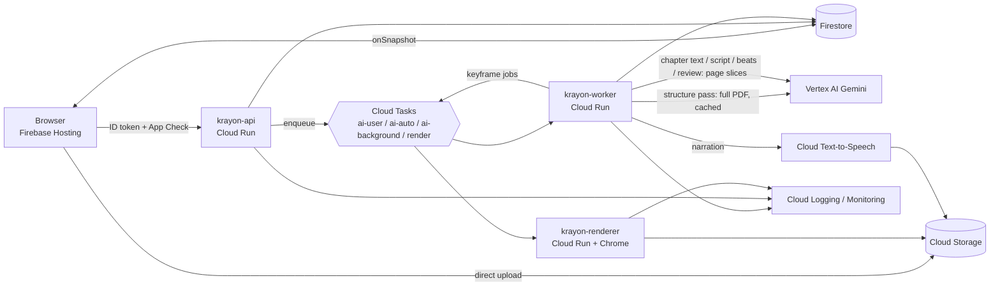

# Krayon production backend on Google Cloud (design)

Status: **design only**. Nothing in this folder is deployed or wired up yet. Today everything runs on a laptop through `local-backend/` (see the table in §2). The same business logic in `packages/pipeline` (behind the interfaces in `packages/shared/src/ports.ts`) is meant to run here unchanged; only the adapters change.

Legend: **Today** = implemented locally · **In progress** = code exists, not wired end to end · **Future** = design only.

## 1. Target product flow (agreed)

| Step | What happens | State |
|---|---|---|
| Structure pass | The only call that sees the whole PDF: title, category, chapters with PDF page ranges, printed-page samples (`structureSchema`) | In progress (schema, `pageRanges.ts`) |
| Chapter text | One call per chapter on that chapter's **page slice** → `chapterText` markdown | In progress (`pdf.ts` slicing, `chapterTextSchema`) |
| Lesson outline | Chapter → lessons with focus and page range (`lessonOutlineSchema`) | In progress |
| Lesson script | `explanationSummary`, 420–660 spoken words (3–5 min at 140 wpm), plus a separate `studyDoc` | In progress (`limits.ts`, schemas) |
| Segments | Script beats → 15–30 segments of 6–15 s (15–35 words each); limits enforced in the backend, not only in prompts | In progress (`beatsSchema`, `limits.ts`) |
| Render | Only **Chapter 1 · Lesson 1** renders automatically; other lessons render when the user clicks. A lesson plays only when **all** its segments are ready | In progress (`LessonStatus`, priority queue) |
| Queue | Priority: user click > viewed course > auto > chapter > background | In progress (`queue.ts`, used by Gemini and render slots) |
| Progress | Per lesson: watched, completed, position | In progress (`users/{uid}/progress/{lessonId}`) |
| Chat | Grounded on segment narration + lesson summary + studyDoc + chapter text | Future (`chatSchema` only) |
| Narration audio | TTS of `explanationSummary`, synced to segment boundaries | Future |
| Pins / notes | Later; today they live in browser localStorage + `users/{uid}/state/study` | Today (local only) |

## 2. Local today → GCP mapping

| Concern | Local today | GCP (future) |
|---|---|---|
| Hosting | Vite dev server :5173; Firebase Hosting site `krayon-ai` already serves `frontend/dist` (`firebase.json`) | Firebase Hosting (same), `/api/**` rewrite to Cloud Run |
| API | Fastify on 127.0.0.1:8787 (`local-backend/src/index.ts`, `routes/courses.ts`) | Cloud Run service `krayon-api` (same Fastify app, new adapters) |
| Auth | `X-User-Id` stub, always `local-user` (`services/auth.ts`) | Firebase Auth ID token, verified with the Admin SDK |
| App Check | Frontend initializes App Check (reCAPTCHA Enterprise, debug token on localhost, `frontend/src/lib/firebase.ts`); backend only redacts the `x-firebase-appcheck` header | Verify App Check tokens on `krayon-api`; enforce on Firestore and Storage |
| Database | SQLite `data/firestore.sqlite3`, table `docs(collection, id, data)` with Firestore-style paths | Firestore (native mode), same paths |
| Files | `data/storage/uploads/<uid>/<blobId>/{content, meta.json}` | Cloud Storage bucket (layout in §4) |
| Jobs | In-process `LocalJobRunner`, `jobs/{id}` docs | Cloud Tasks → Cloud Run worker endpoints |
| Rate limiting / priority | In-memory priority queue, `GEMINI_MAX_CONCURRENCY` (default 4) and render concurrency (default 2) | Cloud Tasks queues per priority with dispatch limits (§5) |
| Events | In-memory bus → WebSocket `/ws` + client refetch | Firestore `onSnapshot` listeners; no WebSocket |
| AI | Vertex AI Gemini via ADC from the laptop (Genkit `vertexAI` plugin; `/api/ai/generate` uses `@google/genai` directly), project `krayon-ai`, location `global` | Same, via the worker's service account; context caching for the structure pass |
| Rendering | `@remotion/renderer` `renderStill` on one shared local Chrome; bundle built once at startup | Cloud Run service `krayon-renderer` with Chrome Headless Shell + prebuilt bundle |
| Logs | `logs/app.jsonl` + `app.log`, request ids, redaction | Cloud Logging (structured JSON), log-based metrics, Monitoring alerts |
| Secrets | `.env` files (gitignored); no key needed with ADC | Secret Manager (only for anything not covered by IAM) |

## 3. Firestore data model (paths taken from `packages/pipeline/src/store.ts`)

| Path | Contents | Written by |
|---|---|---|
| `users/{uid}/courses/{courseId}` | title, category, status (`created/structure/writing/ready/failed`), stage, sources[], error | worker |
| `…/chapters/{chapterId}` (`{courseId}-c{n}`) | index, title, pdfPageStart/End (0-based), skip, status, chapterText* | worker |
| `…/lessons/{lessonId}` (`{chapterId}-l{n}`) | chapterId, index, title, sourcePages, status (`outlined/queued/rendering/ready/failed`), durationFrames, segmentCount, segmentsReady, wordCount, shortSource, explanationSummary, studyDoc*, audio ref | worker |
| `…/lessons/{lessonId}/segments/{sNN}` | status, segment (scene JSON + narration), error, errorInfo | worker |
| `…/segments/{sNN}/rounds/{n}` | review score, issues, keyframe refs, fixed flag | worker |
| `users/{uid}/lessonIndex/{lessonId}`, `chapterIndex/{chapterId}` | id → course lookup | worker |
| `users/{uid}/progress/{lessonId}` | watched, completed, positionFrame, updatedAt | **client** |
| `users/{uid}/state/study` | marks (pins, notes, strokes, doubts, quiz) | **client** |
| `users/{uid}/uploads/{sourceId}` | name, type, size, storage path | api |
| `users/{uid}/pageText/{sourceId}` | pointer to page-text JSON in Storage | worker |
| `ops/jobs/{jobId}` (replaces `jobs/{id}`) | kind, status, attempts, error, for support only | worker |

\* Firestore documents are capped at 1 MiB. Large `chapterText` or `studyDoc` should move to Storage, leaving a pointer.

## 4. Cloud Storage layout (bucket `krayon-ai-content`)

```
users/{uid}/sources/{sourceId}            original upload (PDF/JPG/PNG, ≤ 20 MB, same limit as today)
users/{uid}/pagetext/{sourceId}.json      per-page text + PDF page labels (cached once)
users/{uid}/slices/{sourceId}/{a}-{b}.pdf chapter/lesson page slices sent to Gemini
users/{uid}/keyframes/{lessonId}/{seg}/{round}/{frame}.png   review stills
users/{uid}/audio/{lessonId}/narration.mp3 + timings.json    TTS output and segment marks
```
Uploads go straight from the browser with Firebase Storage rules, or through a V4 signed URL that `krayon-api` issues.

## 5. Services and queues

| Component | Type | Role |
|---|---|---|
| `krayon-api` | Cloud Run service | Auth + App Check checks; create course, render lesson (click), retry, regenerate, chat. Enqueues tasks; never runs long work inline |
| `krayon-worker` | Cloud Run service (HTTP targets for Cloud Tasks) | Pipeline stages: structure, chapterText, outline, script, studyDoc, beats/segments, review/fix, TTS. Each stage is idempotent and resumes from the stored `stage` |
| `krayon-renderer` | Cloud Run service (2–4 vCPU, 4 GB, concurrency 2–4) | `renderStill` keyframes using the bundle baked into the image; writes PNGs to Storage |
| Cloud Tasks queues | `ai-user` (clicks, chat), `ai-auto` (Ch1·L1), `ai-background`, `render` | Priority = which queue; `maxConcurrentDispatches` and `maxDispatchesPerSecond` keep the total under the Vertex quota (≈ today's 4 slots), with retries and exponential backoff on 429/5xx |
| Pub/Sub (optional) | topic `pipeline-events` | Fan-out for analytics or notifications; the UI itself reads Firestore |

"Viewed course first" (local `queue.ts`) has no Cloud Tasks equivalent. Approximate it by putting the viewed course's next lesson on `ai-user`, or by having the worker re-check priority before it starts.



## 6. Gemini, caching, TTS

- **Structure pass:** the only full-PDF call (≈ 258 tokens per page; a 379-page book is ≈ 98k tokens). Use Vertex explicit context caching for the PDF so structure retries and page-label checks reuse it; delete the cache after the stage. (Verify the minimum cache size and TTL for the chosen model.)
- **Every other call** gets a page slice (`pdf.ts` `slice`) or page text, never the whole book. That cuts input tokens ~20× and avoids the 90 s timeouts seen locally.
- **Validation:** keep `generateValidated` (zod + repair attempts) and error codes (`SCHEMA_INVALID`, `NOT_JSON` → 422; `MAX_TOKENS`, `TIMEOUT`, `UPSTREAM` → 502/503) as they are.
- **Narration (future):**
  - Cloud Text-to-Speech with SSML `<mark>` at each beat start and time pointing enabled. The returned timepoints set each segment's real `durationInFrames`, replacing the `framesFor(words)` estimate.
  - Gemini TTS has no timestamps, so it would need forced alignment (e.g. Speech-to-Text word offsets).
  - Store the audio and `timings.json` in Storage; the player adds an `<Audio>` track.

## 7. Security

- **Firestore rules:** a user can read `users/{uid}/**` only when `request.auth.uid == uid`. A client can write only `progress/*` and `state/study`, with schema checks. Courses, chapters, lessons, segments and rounds are server-written only (Admin SDK bypasses rules).
- **Storage rules:** a user can read and write only `users/{uid}/sources/*`, with a content-type allowlist (PDF, JPEG, PNG) and ≤ 20 MB. Everything else is read-only to its owner, and keyframes and slices are server-only.
- **App Check:** enforced on Firestore and Storage. `krayon-api` verifies the `X-Firebase-AppCheck` header. Debug tokens are for localhost only and are registered in the console, never committed.
- **Service accounts (least privilege):**

| SA | Roles |
|---|---|
| `api-sa` | Firestore User, Storage Object Admin (bucket), Cloud Tasks Enqueuer, Service Account Token Creator (signed URLs) |
| `worker-sa` | Vertex AI User, Firestore User, Storage Object Admin (bucket), Cloud Tasks Enqueuer, Cloud TTS (API enabled) |
| `renderer-sa` | Storage Object Creator/Viewer (bucket) only |
| `tasks-invoker-sa` | Cloud Run Invoker on worker and renderer (OIDC tokens on tasks) |

- **Secrets:** none needed for Gemini or TTS (IAM). Secret Manager holds anything else (e.g. a reCAPTCHA Enterprise key if used server-side). Keep the local redaction rules for auth, cookie, API-key and App Check headers in Cloud Logging.

## 8. Observability

- **Logs:** keep the JSON log contract. Map `level` to `severity` and `request_id` to `logging.googleapis.com/trace`; tasks carry the originating request id.
- **Log-based metrics:** Gemini latency and queue wait (the priority queue already reports wait time), 429 count, `segment.failed` / `lesson.failed` by error code, render duration.
- **Alerts:** 429 rate, worker error rate, task queue age, render p95.

## 9. Rough cost notes (verify current list prices before relying on them)

| Item | Estimate |
|---|---|
| Gemini 2.5 Flash (≈ $0.30 / 1M input, $2.50 / 1M output) | Structure pass on a 379-page book ≈ $0.03. Per lesson with slices (chapter text share, script, studyDoc, beats, 15–30 segments + reviews) ≈ $0.05–0.20. Full-book resend on every call (today's topic pipeline) ≈ $0.25 per topic: avoid it |
| Cloud TTS | ≈ 4k characters per lesson (660 words). Roughly $0.02–0.15 per lesson depending on the voice tier |
| Cloud Run | Renderer ≈ 1 s CPU per keyframe × ≤ 8 × 15–30 segments per lesson: cents per lesson. Scale to zero when idle |
| Firestore / Storage / Tasks / Hosting | Negligible at hackathon scale; free tiers cover most of it |

## 10. Open questions

1. Cloud Tasks priority vs a single worker-side priority queue (Firestore lease or Redis/Memorystore): how strict must "viewed course first" be?
2. Renderer: self-hosted `renderStill` on Cloud Run vs `@remotion/cloudrun` (check its maintenance status and licence terms for company use).
3. TTS voice: Cloud TTS voices with SSML marks vs Gemini TTS + alignment. Do the HD voices support `<mark>`?
4. Does audio length become the source of truth for segment duration (re-layout after TTS)?
5. Big `chapterText` / `studyDoc`: Firestore field vs Storage object (1 MiB doc limit).
6. Retention: delete slices and keyframes after a lesson is ready? Should review rounds be kept?
7. Multi-file courses (PDF + photos): how does the structure pass merge sources?
8. Per-user quotas and abuse limits (uploads per day, max pages per book).
9. Region: Vertex `global` endpoint vs a pinned region (data residency, quota pool).
10. Marks sync: move pins and notes from localStorage + one blob doc to per-item Firestore docs?
